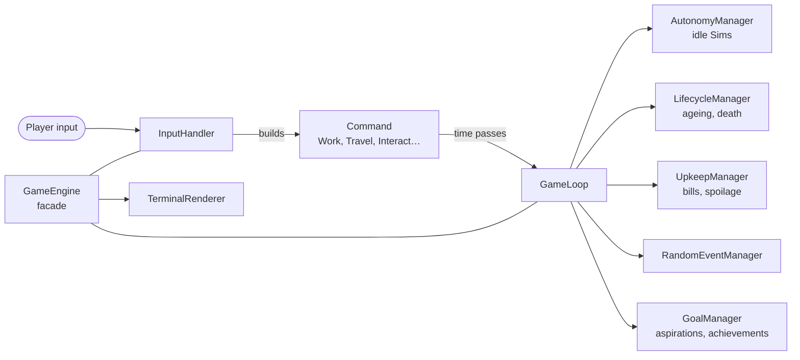

# SimCLI

**Live, work and love — right in your terminal.**

[](https://github.com/BlackberryDealer/Sims-CLI-game/actions/workflows/tests.yml)


SimCLI is a life simulation game inspired by *The Sims*, written in plain Java and played entirely in the terminal. You run a household of up to four Sims: keep them fed, rested and happy, find them careers, make friends at the park, fall in love, raise children, and see them through to old age. Every Sim has a life goal, and when the whole household has fulfilled theirs, you've won.

```
╔════════════════════════════════════════════════════════════════════════════╗
║ DAY 1  Monday  ☼ 08:00 Morning                   The Shared Dorm ► Bedroom ║
╚════════════════════════════════════════════════════════════════════════════╝

            (  )  (  )
             )||    ||
        ______||____||___________________
       /                                /|
      /   ~ T H E   D O R M ~          / |
     /________________________________/  |
     |  [##]  [##]   ____   [##]  [##]|  |
     |  [##]  [##]  |    |  [##]  [##]|  /
     |______________|   o|____________| /
   ,,'',,,'',,,,'',,,,,'',,,,'',,,,'',,,'',,

┌─ ★ ANN  27 · Adult · Unemployed ───────────────────────────────────────────┐
│ Hunger   ██████████████████ 100     Energy   ██████████████████ 100        │
│ Hygiene  ██████████████████ 100     Fun      ██████████████████ 100        │
│ Social   ██████████████████ 100     Health   ██████████████████ 100        │
│ $500   bag 0/10   traits Lazy   feeling fine                               │
└────────────────────────────────────────────────────────────────────────────┘
┌─ Household ────────────────────────────────────────────────────────────────┐
│ ★ Bob  ♥ 100                                                               │
└────────────────────────────────────────────────────────────────────────────┘
┌─ What should Ann do? ──────────────────────────────────────────────────────┐
│ HERE  [1] Sleep till 08:00                                                 │
│ OUT   [W] Work        [T] Travel (1h) [J] Jobs                             │
│ HOME  [M] Move room   [H] House info  [U] Upgrade room                     │
│ SIM   [I] Status      [V] Inventory   [K] Switch Sim  [G] Goals            │
│ GAME  [?] Help        [S] Save & quit to menu                              │
│ Using things here takes 1 hour; menus and info screens are free.           │
└────────────────────────────────────────────────────────────────────────────┘
```

## Contents

- [Quick start](#quick-start)
- [Your first day](#your-first-day)
- [Controls](#controls)
- [Game guide](#game-guide)
- [Adding content](#adding-content)
- [Building and testing](#building-and-testing)
- [Architecture](#architecture)
- [Contributors](#contributors)

## Quick start

You need **Java 17 or newer**. The game has no runtime dependencies.

**Any OS, with Maven:**

```bash
git clone https://github.com/BlackberryDealer/Sims-CLI-game.git
cd Sims-CLI-game
mvn package
java -jar target/sims-cli-game.jar
```

**Windows, without Maven:** double-click `run.bat`, or run it from a terminal. It finds a JDK by itself: `JAVA_HOME` first, then `javac` on your `PATH`, then the JDK bundled with VS Code's Java extension, then the usual install folders. If it can't find one, install one with `winget install EclipseAdoptium.Temurin.21.JDK`.

> **Tip:** use a terminal that supports colour and Unicode, such as Windows Terminal, the VS Code terminal, or any macOS or Linux terminal. Older consoles still work, with plain ASCII boxes instead.

## Your first day

1. **Make a household.** Choose **New world**, name it, and create up to four Sims. Each Sim gets a random personality (Active, Lazy or Socialite), and you pick their **life aspiration**, the goal that wins you the game.
2. **Get a job.** Press `J` and pick a career you're old enough for. Each career rewards one skill, so pick one you can train. Press `W` to work a shift; the office is closed at weekends.
3. **Buy food.** Press `T` to travel to the **Town Supermarket**. Ready meals are convenient, but raw **Groceries** are far cheaper per bite. Bring them home and open the fridge: `C` cooks a meal, `S` stores food so it stays fresh longer.
4. **Meet people.** Travel to the **City Park** and chat with the visitors. Chats always land; jokes and flirts are riskier. Keep talking to someone and you'll become friends, and maybe more.
5. **Go to bed.** Sleeping skips to 08:00 and the whole household goes to bed with you. In the morning you'll see what changed overnight, e.g. `Hunger 72 → 49`.
6. **Plan for Monday.** Bills for every home you own are due each Monday.

The Sims you aren't controlling look after themselves: they eat from the fridge, shower and nap. Press `K` to switch to one of them. Press `?` in game for help at any time.

## Controls

| Key | Action | Time |
|---|---|---|
| `1`–`9` | Use what's listed under **HERE**: bed, fridge, shower, shop, park… | 1 hour (sleep lasts until 08:00) |
| `W` | Work a shift (weekdays only) | the shift's length |
| `T` | Travel somewhere, or buy a home | 1 hour |
| `J` | Job market: take a job, change career, or quit | free |
| `M` / `H` / `U` | Move room / house info and bills / upgrade a room ($500) | free |
| `I` | Status: needs, job, skills, family, friends | free |
| `V` | Inventory: eat, use or drop items | free |
| `K` | Switch to another Sim in the household | free |
| `L` | Family: date your spouse, try for a baby, feed the babies, give a gift | 1 hour |
| `G` | Goals: aspirations and achievements | free |
| `?` | Help | free |
| `S` | Save and quit to the main menu | free |

`0` goes back in every menu. Backing out of a shop, the fridge or the park without doing anything costs no time.

## Game guide

The full rules, for when you want the details. Click a section to open it.

<details>
<summary><b>Needs, health and death</b></summary>

Every Sim has five needs from 0 to 100: **Hunger**, **Energy**, **Hygiene**, **Fun** and **Social**. They fall every hour, faster when working or exercising, and faster for older Sims. Low needs drag each other down: poor hygiene hurts social, and low fun and loneliness drain energy.

- **Health** regenerates while a Sim is fed, drains slowly while they're hungry (hunger 20 or below), and drains faster every hour they're starving at 0. A Sim dies when health reaches 0, and that includes babies.
- **Tired** Sims (energy 20 or below) can't work or exercise. **Hungry** Sims can't work.
- **Personality** matters: Active Sims tire 20% slower and Lazy Sims 50% faster. Socialites get 50% more out of chats, jokes and flirts, and learn Charisma faster.

</details>

<details>
<summary><b>Careers and skills</b></summary>

| Job | Pay per shift | Hours | Ages | Tiers | Skill |
|---|---|---|---|---|---|
| Software Engineer | $150 | 4 | 18–65 | 5 | Logic |
| Hardware Technician | $120 | 5 | 18–55 | 4 | Logic |
| Freelance Photographer | $80 | 2 | 18–80 | 3 | Charisma |
| Personal Trainer | $90 | 3 | 18–40 | 3 | Fitness |
| Barista *(part-time)* | $45 | 3 | 13–75 | 3 | Charisma |
| Lifeguard *(part-time)* | $50 | 3 | 13–45 | 3 | Fitness |
| Library Assistant *(part-time)* | $40 | 3 | 13–80 | 3 | Logic |

Pay is the tier-1 rate and rises with each promotion.

- **Promotions** have a 25% chance per shift, plus 5% per level of the job's skill (up to 75%). Past tier 2 the skill is required: tier 3 needs level 2, tier 4 needs level 4, and tier 5 needs level 6.
- **Skill pays:** each level of the job's skill adds 5% to every paycheck.
- **Overwork:** extra shifts in one day cost more energy, hunger and hygiene each time (double, then triple), and the game asks you to confirm the first one.
- **Attendance:** missing more than three weekdays in a row gets a Sim fired. Weekends never count.
- **Retirement:** Sims past a job's maximum age are retired from it. Unemployed elders collect a $100 pension on each birthday.

| Skill (0–10) | How to train it | What it does |
|---|---|---|
| Fitness | Weight Bench (Active Sims learn 50% faster) | Cheaper workouts; pay and promotions for fitness jobs |
| Logic | Computer; teens also learn it at school | Pay and promotions for logic jobs |
| Charisma | Chatting, joking, flirting and dates (Socialites learn 50% faster) | Jokes and flirts land more often and build relationships faster |

Working a shift trains the job's skill a little too. The status screen (`I`) shows each skill's progress and what the next promotion needs.

</details>

<details>
<summary><b>Money, food and bills</b></summary>

- **Starting money:** each Sim you create starts with $500. Every Sim has their own wallet; babies start with nothing.
- **Bills:** every Monday the household pays the weekly bill for each home it owns: $100 for the Dorm and $250 for the Bungalow. The richest Sim pays first. If the household can't cover it, everyone loses happiness. `H` shows what's due.
- **Cooking:** raw ingredients barely fill you up raw, but cooked at a fridge (`C`) they become proper meals.

  | Food | Price | Hunger | Notes |
  |---|---|---|---|
  | Apple | $10 | +15 | snack |
  | Microwave Dinner | $30 | +40 | ready to eat |
  | Groceries | $15 | +10 raw, **+55** cooked | cooks into a Home-cooked Meal |
  | Raw Steak | $35 | +15 raw, **+80** cooked | cooks into a Steak Dinner |

- **Spoilage:** food stays fresh for a few days. It loses 1 day of freshness a day in a fridge and 2 a day in a bag or storage chest, and is thrown out when it runs out.
- **The Bookshop** sells books (for fun), a Computer, and Energy Drinks for adults.
- **The Bungalow** costs $5,000 and comes with its own Computer for studying.
- **Upgrades:** `U` expands a room's storage for $500.

</details>

<details>
<summary><b>Relationships, marriage and children</b></summary>

- **Social actions:**

  | Action | Odds | Effect |
  |---|---|---|
  | Chat | always lands | small, steady relationship gain |
  | Joke | 60% | bigger gain if it lands |
  | Flirt | 40% and up | the biggest gain; adults who already know each other (20+) only |
  | Argue | always "lands" | hurts the relationship |

  The menu shows the odds for each action. Charisma raises them, a Socialite target is easier to win over (+15%), and a Lazy one is harder (−10%). A flop costs a little relationship and happiness.
- **Relationship levels:** stranger → acquaintance (20) → friend (50) → romantic (80) → married. At 100 you can propose, and your new spouse joins the household as a playable Sim.
- **Family menu (`L`):** go on dates, try for a baby (a 50% chance; it takes an hour either way), feed the babies, or give your spouse a gift from your bag. Pricier gifts mean more.
- **Children** are born as babies who only need feeding. They grow a year every day and become playable at 13. Teens go to school on weekdays (+Logic) and can take part-time jobs.
- **The park** has eight visitors a day, drawn from a town that remembers who you've met. Each morning three leave and others arrive, either old faces or new ones. Townsfolk age too, and move away at 80.

</details>

<details>
<summary><b>Ageing and life stages</b></summary>

| Stage | Ages | Notes |
|---|---|---|
| Child | 0–12 | ages one year **per day**; babies only need feeding |
| Teen | 13–17 | playable; school on weekdays; part-time jobs |
| Adult | 18–64 | every career open |
| Elder | 65+ | pension when unemployed; dies of old age at 90 |

Teens, adults and elders age one year every 3 in-game days. New households start with Sims aged 18–89.

</details>

<details>
<summary><b>Goals: aspirations, achievements and winning</b></summary>

Every playable Sim has one **aspiration**. Fulfilling it pays $1,000 and a big mood boost. When every playable Sim in the household has fulfilled theirs, your **legacy is complete** and you've won. You can keep playing afterwards.

| Aspiration | Goal |
|---|---|
| Career Star | Reach the top tier of a career |
| Big Family | Raise a family of 3 children |
| Homeowner | Buy the Bungalow |
| Master of One | Reach level 10 in any skill |
| Social Butterfly | Make 5 good friends (relationship 50+) |

**12 achievements** mark household milestones: Gainfully Employed, Moving Up, Corner Office, Good Friends, Wedding Bells, Bundle of Joy, All Grown Up, Moving On Up, Skilled, Master, Moneybags ($10,000 saved) and Golden Years. `G` shows everyone's progress and which achievements you've unlocked.

</details>

<details>
<summary><b>Random events</b></summary>

After every turn there's a **5% chance** of an event for the Sim you're playing:

| Event | Effect |
|---|---|
| Found money | +$50 |
| Stubbed toe | −15 fun |
| Stroke of inspiration | +20 energy |
| Mild cold | −10 to every need |
| Stove fire | −20 hunger, −25 energy, −10 health |
| Lottery win | +$100 to $500, +30 fun |

There's also a separate **4% chance** of a **household event**, chosen from the ones that fit the time:

| Event | When | Effect |
|---|---|---|
| Sunny morning | 06:00–11:00 | +10 fun for everyone |
| Neighbour's pie | 12:00–17:00 | +10 social, and a pie in the fridge |
| Weekend party | Sat/Sun evenings | +25 social, +15 fun, −10 energy for everyone awake |
| Power cut | 21:00–05:00 | −10 hygiene; fridge food loses 2 days of freshness |
| Flu | any time | −15 energy, −10 fun for everyone |

</details>

<details>
<summary><b>Saving, settings and display</b></summary>

- **Saves** live in `saves/<world name>.txt`, in the folder you run the game from. Pressing `S` saves and quits, and the game also autosaves regularly as you play. You can load or delete worlds from the main menu.
- **Settings** in the main menu turn colours and animations on or off.
- **Colour detection** is automatic. Force it with `SIMCLI_COLOR=always` or `SIMCLI_COLOR=never`; `NO_COLOR` is honoured too.
- **ASCII fallback:** consoles that can't show box-drawing characters fall back to plain ASCII automatically.

</details>

## Adding content

Shops and the city are plain JSON files in [`resources/simcli/data/`](resources/simcli/data). Edit them to add items, shops or buildings, with no Java required. Each file starts with a comment describing its fields.

For example, to sell coffee at the supermarket, add this to the grocery shop's `items` in [`shops.json`](resources/simcli/data/shops.json):

```json
{ "type": "food", "name": "Iced Coffee", "price": 6, "hunger": 5, "energy": 15 }
```

- **[`shops.json`](resources/simcli/data/shops.json)** — what each shop sells: food, raw ingredients (with the meal they cook into), consumables like books, and furniture. Items can be restricted with `availableIf`, for example `[{ "minAge": 25 }, { "minMoney": 500 }]`, meaning age 25+ *or* $500+.
- **[`buildings.json`](resources/simcli/data/buildings.json)** — the travel map, in order: homes (price, weekly bill, rooms and furniture), shops (by shop id) and the park. Add new buildings at the **end** of the list, because saves refer to buildings by position.

Jobs are still defined in code ([`Job.java`](src/simcli/entities/models/Job.java)), because saves and game logic refer to them by name.

## Building and testing

| Task | Command |
|---|---|
| Build, test and package | `mvn package` → `target/sims-cli-game.jar` |
| Run the tests | `mvn test`, or `run-tests.bat` on Windows without Maven |
| Run without Maven | `javac -d bin -sourcepath src src/simcli/Main.java` then `java -cp "bin;resources" simcli.Main` (use `:` instead of `;` on macOS/Linux) |
| Generate Javadoc | `javadoc -d docs -sourcepath src -subpackages simcli`, then open `docs/index.html` |

The suite has about 390 JUnit 5 tests: unit tests for each manager, integration tests that play through commands, save/load round trips, and regression tests for UI and timekeeping bugs. [GitHub Actions](.github/workflows/tests.yml) runs them on **Windows, macOS and Linux** for every push and pull request.

## Architecture

The code is organised around a handful of classic design patterns, chosen to keep each part of the simulation small and testable.



Each turn, `GameEngine` renders the screen, and `InputHandler` turns the key you pressed into a **Command**. If the command takes time, `GameLoop` simulates it hour by hour: idle Sims act, needs decay, the clock advances, and at midnight it runs ageing, school, bills, spoilage and the park's daily rotation. After the turn it rolls for random events and checks goals.

| Pattern | Where | Why |
|---|---|---|
| Command | `engine/commands/` | Every action is an `ICommand`, dispatched by `InputHandler` |
| State | `entities/lifecycle/` | `ChildStage` → `TeenStage` → `AdultStage` → `ElderStage` change what a Sim can do |
| Facade | `GameEngine` | One entry point that hides the subsystems |
| Builder | `CommandContext.Builder` | Commands get a validated context instead of the whole engine |
| Strategy | `needs/` | Each need defines its own decay rule |
| Template Method | `BaseCommand` | Shared command flow; subclasses fill in `run()` |
| Factory | `InteractableFactory` | Furniture is built by name, from saves and JSON |
| Dependency injection | throughout | `IRenderer`, `IWorldManager` and `IInputHandler` can be swapped for test doubles |

Other decisions: commands never hold a `GameEngine` reference (no circular dependencies), each concern has its own manager class, and tuning numbers live in [`GameConstants`](src/simcli/utils/GameConstants.java). There's a full UML class diagram in [`class-diagram.mmd`](class-diagram.mmd).

### Where things live

| Path | What's there |
|---|---|
| `src/simcli/engine/` | Game loop, input, time, world, and the managers for autonomy, lifecycle, upkeep, events and goals |
| `src/simcli/engine/commands/` | One class per player action |
| `src/simcli/entities/` | Sims and NPCs, items, life stages, per-Sim managers (career, skills, relationships, inventory) and enums |
| `src/simcli/needs/` | The five needs and the tracker that ties them to health |
| `src/simcli/persistence/` | Save files and the JSON content loader |
| `src/simcli/ui/` | Menus, HUD, panels, colours and ASCII art |
| `src/simcli/world/` | Buildings, rooms and everything a Sim can interact with |
| `resources/simcli/data/` | Shops and buildings as JSON |
| `test/simcli/` | The JUnit 5 suite, mirroring `src/` |

## Contributors

AfifLotfi · BlackberryDealer · colossalcap · Dylan Ho Sheng Xue · Johndose-val · lucas · macfreze12 · Muhammad Hasan Bin Suwandi

## License

Developed as an academic object-oriented programming assignment.
